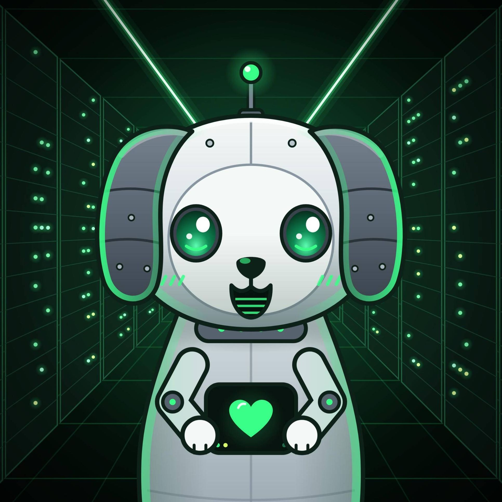

# PuppyBot

<p align="center">
  
</p>

A Discord bot of the Purple Puppy Project, written in Rust; a Signal bot may follow.

**Status: being built.** So far PuppyBot connects to Discord, works only on the servers that its [configuration](#configuration) names, answers [`/info`](#commands), rolls [dice](#dice), posts [polls](#polls), and answers text commands such as `!info`, in German or English, and keeps the language and the prefix of each server in its database. What the bot will do, with which libraries, and the next steps are in [docs/PLAN.md](docs/PLAN.md).

The project holds itself to:

- **100 % test coverage:** CI fails if the tests leave a single line or function uncovered.
- **Fuzzing:** every parser of input from outside has a fuzz target, run on each pull request and longer once a week.
- **Conservative security:** no `unsafe`, strict Clippy lints, checked dependencies, pinned GitHub Actions, a Docker image without shell or root, and attestations of where binaries and image were built.

## Setting Up the Bot on Discord

PuppyBot works only on servers that you choose, so it is a private bot: only you can add it to servers. In the [Developer Portal](https://discord.com/developers/applications):

1. Create an application with **New Application**.
2. On **Installation**, check only **Guild Install** under **Installation Contexts**, and set the **Install Link** to **None**: a private bot can't have one.
3. On **Bot**, turn **Public Bot** off, and get the token with **Reset Token**. It goes into the token file, see [Docker Compose](#docker-compose). Under **Privileged Gateway Intents**, turn on **Message Content Intent**, which the [text commands](#text-commands) need: without it, Discord closes the connection with the code 4014 and PuppyBot stops. Under 100 servers, Discord allows it without a review.
4. On **OAuth2**, let the **URL Generator** make a link with the scopes `bot` and `applications.commands`, as a guild install, and the permissions **View Channels**, **Send Messages**, **Read Message History** and **Create Polls**, with which PuppyBot answers text commands in the channel and posts polls. Open it to add the bot to a server; you need the permission "Manage Server" there. On a server that has the bot already, give it these permissions, e.g. by opening the new link.
5. In Discord, turn on the developer mode (User Settings, Advanced), choose **Copy Server ID** in the menu of the server, and put the ID into `guilds` in the [configuration](#configuration).

PuppyBot registers its commands only on the servers in `guilds`, and leaves any other server it is on, with a warning in its log.

## Commands

| Command | What it does |
|---|---|
| `/info` | Shows what PuppyBot is, which version runs, and where its code is |
| `/settings language` | Shows the language in which PuppyBot writes to everyone on the server, or changes it with `to`: German or English, by default English. Only for people who may manage the server |
| `/dice`, in German `/würfel` | Rolls [dice](#dice), e.g. `2d6+3`, for everyone in the channel to see; with `secret`, only for the person who asked |
| `/poll`, in German `/umfrage` | Posts a [poll](#polls) in the channel, which Discord shows and counts |
| `/settings prefix` | Shows the prefix of the text commands on the server, or changes it with `to`: 1 to 5 characters of ASCII that one can see, but no spaces and none of `` < > @ # : / ` ``, by default `!`. Only for people who may manage the server |

PuppyBot's answers are shown only to the person who asked, except those of `/dice`, and mention nobody. They are in German for people whose Discord is in German, and in English for everyone else; the language of the server is for what PuppyBot writes to everyone, e.g. welcome messages, which come later.

Discord shows `/settings` only to people with the permission "Manage Server" or "Administrator". The server's admins can allow it to others in the server settings (Integrations), but PuppyBot answers only those who have one of the two permissions.

### Text Commands

Messages that start with the prefix of the server, `!` unless someone chose another, or with a mention of PuppyBot, are text commands, e.g. `!info` or `@PuppyBot info`. A mention alone shows the help.

| Text command | What it does |
|---|---|
| `!info` | Shows what PuppyBot is, which version runs, and where its code is |
| `!dice`, `!roll`, `!würfel` | Rolls [dice](#dice), e.g. `!würfel 2W6+3`, one die with six sides without an expression |
| `!poll`, `!umfrage` | Posts a [poll](#polls), e.g. `!umfrage Pizza oder Pasta? \| Pizza \| Pasta` |
| `!help`, `!hilfe` | Shows the text commands and the prefix |

- The names work in any case, e.g. `!Hilfe`, and directly after the prefix: `! info` is no command.
- PuppyBot answers in the channel, as a reply that mentions nobody, in the language of the server, as everyone in the channel sees it.
- It ignores the messages of bots and webhooks, and commands it doesn't know, which may be for other bots with the same prefix.
- It reads the text of every message on its servers, to find the commands, but keeps none of it.

### Polls

PuppyBot posts polls as Discord's own, which Discord shows and counts; nobody's vote is in PuppyBot's database. A poll has a question of up to 300 characters, 2 to 10 answers of up to 55 characters, and runs 1 to 168 hours, 7 days, by default 24.

- `/poll` takes the question, `answer1` to `answer10`, of which the first two are needed, `hours`, and `multiple`, if one may choose more than one answer. PuppyBot posts the poll in the channel and tells the person who asked that it did, or why it couldn't.
- `!poll` or `!umfrage` takes the question and the answers, separated by `|`, and posts the poll as the reply, for 24 hours, with one answer each.
- PuppyBot needs the permission Create Polls in the channel, besides Send Messages.

### Dice

| Expression | What it rolls |
|---|---|
| `2d6`, `2W6` | Two dice with six sides, and their sum; `W` is the German notation |
| `d20` | One die with twenty sides |
| `2d6+3`, `3d8-2+1d4` | Dice and numbers, added and subtracted |
| `4d6kh3`, `4d6k3` | Four dice, of which the highest three count |
| `2d20kl1` | Two dice, of which the lowest counts |

The case doesn't matter, and spaces may stand around `+` and `-`. PuppyBot rolls at most 100 dice at once, with up to 1000 sides, in at most 20 terms, with numbers up to 1000000, and expressions of up to 100 characters. The dice come from the randomness of the system, through ring, which TLS uses too, so nobody can guess the next roll from the last ones. Dice that don't count are struck through, e.g. `[6, ~~2~~, 5] = **11**`.

## Docker

The bot is deployed as a Docker image, for amd64 and arm64:

- `ghcr.io/purplepuppyproject/puppybot`
  - `latest`: the newest [release](https://github.com/PurplePuppyProject/PuppyBot/releases) that isn't a pre-release. Until there is one, the latest commit on `main`.
  - `<version>`, e.g. `0.1.0`: a release, also a pre-release.
  - `edge`: the latest commit on `main`; `sha-<commit>`: an earlier commit.

The image is based on [distroless static](https://github.com/GoogleContainerTools/distroless): the static binary, CA certificates and time zone data, but no shell, no package manager and no C library. It runs as the user `65532` without privileges and capabilities, and writes only its database, in `/var/lib/puppybot`, which belongs in a volume, see [Docker Compose](#docker-compose). Without the database, e.g. for the version:

```sh
docker run --rm --read-only --cap-drop ALL --security-opt no-new-privileges \
  ghcr.io/purplepuppyproject/puppybot:edge --version
```

### Docker Compose

[docker/example](docker/example) runs the bot with [Docker Compose](https://docs.docker.com/compose/): `compose.yaml`, and the [configuration](#configuration) `config.toml`, which names the token file. In that directory:

1. Put the token of the bot into the file `discord_token`, readable only by the user of the image. `read -s` keeps the token out of the shell's history and off the screen:
   ```sh
   (umask 077 && read -rsp 'Discord token: ' token && printf '%s\n' "$token" > discord_token)
   sudo chown 65532:65532 discord_token
   ```
2. Put the IDs of your servers into `guilds` in `config.toml`, see [Setting Up the Bot on Discord](#setting-up-the-bot-on-discord).
3. Start the bot with `docker compose up -d`. `docker compose logs` shows its log, `docker compose stop` stops it.

The container runs read-only, without capabilities and without gaining privileges. Compose gives it the token as the secret `/run/secrets/discord_token`, a file, which unlike an environment variable doesn't show in `docker inspect`.

The database is in the volume `data`, which outlives the container; `docker compose down --volumes` deletes it. A directory of the host instead of the volume must belong to the user of the image: `sudo chown 65532:65532 <directory>`. To back the database up, copy its file while the bot is stopped:

```sh
docker compose stop
docker compose cp puppybot:/var/lib/puppybot/puppybot.redb puppybot-backup.redb
docker compose start
```

CI runs the example with each change, with a token that Discord rejects: so it checks that the image gets as far as Discord, see `docker/test-example.sh`.

### Checking the Image

To check that an image was built by this repository's workflow:

```sh
gh attestation verify oci://ghcr.io/purplepuppyproject/puppybot:edge --repo PurplePuppyProject/PuppyBot
```

The binary carries the list of the crates it was built from ([cargo-auditable](https://github.com/rust-secure-code/cargo-auditable)), and the image an SBOM that lists them, so scanners find vulnerable crates in it, e.g. `trivy image ghcr.io/purplepuppyproject/puppybot:edge`. To see the SBOM:

```sh
docker buildx imagetools inspect ghcr.io/purplepuppyproject/puppybot:edge --format '{{ json .SBOM }}'
```

## Configuration

PuppyBot reads its settings from a [TOML](https://toml.io) file: `/etc/puppybot/config.toml`, where the Docker image expects it, or the file that `--config` names, e.g. `puppybot --config bot.toml`.
[docker/example/config.toml](docker/example/config.toml) has every setting:

| Key | Default | What it sets |
|---|---|---|
| `[discord]` `token-file` | none, it must be given | The file with the token of the bot, e.g. a Docker secret |
| `[discord]` `guilds` | none, it must be given | The IDs of the servers that PuppyBot works on, e.g. `[123456789012345678, 234567890123456789]`: it registers its commands only there, and leaves any other server |
| `[discord]` `gateway-url`, `api-url` | Discord's | For tests only: a gateway (`ws://`) and an API (`http://`) on this machine, e.g. `ws://127.0.0.1:8080`. Other addresses are errors, so that a changed configuration can't send the token elsewhere. |
| `[storage]` `path` | `/var/lib/puppybot/puppybot.redb` | The file of the database, which PuppyBot creates if it is missing. It must be on a disk of this machine, and only one PuppyBot at a time can use it. |
| `[log]` `level` | `info` | The most detailed level that is logged: `error`, `warn`, `info`, `debug` or `trace` |
| `[log]` `format` | `text` | `text`, a line per message, or `json`, a JSON object per line, for log collectors |

- **Checked:** unknown keys, e.g. typos, and invalid values are errors: PuppyBot names the line and exits with the status 2.
- **Paths:** a relative path, e.g. `token-file = "token"`, is relative to the directory of the configuration file.
- **Secrets** come only from files that the configuration names, never from the configuration itself, the command line or environment variables, and are never logged. The token file holds the token, with line breaks at its end or without; a character that isn't printable ASCII, e.g. a space, or a file larger than 4 KiB is an error. PuppyBot warns if users other than its owner may read or change the file.
- **`RUST_LOG`**, e.g. `RUST_LOG=debug` or `RUST_LOG=info,puppybot=trace`, takes precedence over `[log]` `level`, to find a bug.

## Running and Stopping

PuppyBot runs until `SIGTERM`, which `docker stop` and service managers send, or `SIGINT`, from Ctrl+C, stops it. Then it closes the connection to Discord, and waits for Discord to close it too, for at most 5 seconds, within the 10 seconds that `docker stop` waits. If the connection breaks before, PuppyBot connects again by itself. It logs to stderr, which Docker collects. Its exit status is:

- 0 when a signal stopped it, or after `--version` or `--help`;
- 1 if it can't run, e.g. as the token file is missing or holds no valid token, as the system has no CA certificates, as the database can't be used, or as Discord closed the connection for good, e.g. with the code 4004, as it rejected the token, or 4014, as the Developer Portal doesn't allow the Message Content Intent;
- 2 for a command line, a configuration file or a `RUST_LOG` that PuppyBot can't use.

## Project Layout

| Path | What it holds |
|---|---|
| `crates/puppybot-core` | The bot's logic, its parsers and its texts in German and English, without Discord, storage or I/O |
| `crates/puppybot` | The program: its command line, configuration, secrets, logging and signals, the connection to Discord with its commands, and the database; later feeds |
| `fuzz/` | The fuzz targets, a workspace of its own, see [fuzz/README.md](fuzz/README.md) |
| `docker/` | The Dockerfile, the script that prepares its build context, the check of its SBOMs, and the example of Docker Compose with its test |
| `utils/` | `set-version.sh`, which prepares a release |
| `docs/` | `PLAN.md`, with what was decided in planning and the next steps, and the logo, `puppybot_logo.jpg` |

## Development

### Getting Started

Install Rust with [rustup](https://rustup.rs). The bot builds with the current stable Rust, and with Rust 1.90 or newer (`rust-version` in `Cargo.toml`, checked by CI).
The checks need some tools:

```sh
rustup component add llvm-tools-preview
cargo install cargo-llvm-cov cargo-deny
pipx install zizmor   # optional: make check uses it if it is installed
```

The `Makefile` holds the commands that CI runs, e.g. `make test`, `make lint` and `make run ARGS=--help`, with a list of all its targets at the top.
Before pushing, run everything a pull request must pass:

```sh
make check
```

It checks the formatting (`cargo fmt`), runs Clippy and builds the docs with all warnings as errors, checks that `puppybot-core` depends on no crate with I/O, runs the tests with the coverage check, checks the dependencies, and audits the workflows if zizmor is installed.

### Tests and Coverage

`make coverage` runs the tests with [cargo-llvm-cov](https://github.com/taiki-e/cargo-llvm-cov) and fails if they cover less than 100 % of the lines or of the functions (`COVERAGE_MIN` in the `Makefile`).
It prints a summary per file, writes an HTML report with the covered lines to `target/llvm-cov/html` and an LCOV report to `target/llvm-cov/lcov.info`.

- The program in `crates/puppybot/src/main.rs` only hands over to its library, and the tests in `crates/puppybot/tests/` start it, so its coverage counts too.
- No test reaches the real Discord: the tests in `crates/puppybot/tests/` run the program against a gateway and an API on the test machine (`tests/common`), which check what it sends, e.g. its token, its commands and its answers. Only the test of the Docker image talks to Discord, see [Docker Compose](#docker-compose).
- The coverage of a generic function is that of its best instantiation, not of all of them together. Functions that the tests need to call with other types, e.g. writers that fail, take trait objects (`&mut dyn Write`) instead.
- The same holds for the library's functions, which are compiled twice: into its unit tests, and into the program that the integration tests start. A function counts only with the better of the two, so one of them must cover all of it. If the summary counts a missed line that `--show-missing-lines` doesn't list, the two cover it only together, e.g. a branch that only a unit test reaches.

### Fuzzing and Dependency Checks

The fuzz targets in `fuzz/` feed random input to the parsers.
They need a nightly toolchain and [cargo-fuzz](https://github.com/rust-fuzz/cargo-fuzz); `make fuzz` runs each of them for a minute, see [fuzz/README.md](fuzz/README.md).
`make test` runs a short smoke test of the same functions on stable Rust.

[cargo-deny](https://github.com/EmbarkStudios/cargo-deny) checks the dependencies for known vulnerabilities, unmaintained crates, licenses that don't go with the GPL, and sources other than crates.io, as configured in `deny.toml`:

```sh
make deny
```

### CI

| Workflow | Runs on | Checks |
|---|---|---|
| `lint.yml` | pull requests, `main` | rustfmt, Clippy and rustdoc, with a pinned Rust version, so new lints don't break unrelated changes |
| `rust-build.yml` | pull requests, `main` | the debug build, and `cargo check` with the oldest supported Rust (MSRV) |
| `rust-test.yml` | pull requests, `main` | the tests |
| `coverage.yml` | pull requests, `main` | 100 % of lines and functions; the summary is on the run's page, the reports are an artifact and go to Codecov |
| `fuzz.yml` | pull requests (30 s per target), weekly (15 min), by hand | the fuzz targets |
| `deny.yml`, `audit.yml` | pull requests, `main`, weekly | the dependencies, with cargo-deny and cargo-audit |
| `codeql.yml` | pull requests, `main`, weekly | CodeQL's analysis of the Rust code and of the workflows |
| `zizmor.yml` | pull requests, `main`, weekly | the workflows, with zizmor: e.g. template injection, permissions, known vulnerable actions |
| `release.yml` | pull requests, `main`, version tags | the static binaries, tested on amd64 and arm64, with the list of their crates checked by `cargo audit bin`, and the Docker image with its SBOMs; publishes them for `main` and version tags, see [Releasing](#releasing) |

Dependabot proposes updates of the crates, the base image and the GitHub Actions once a week, each kind in one pull request, and only for versions at least a week old.
All GitHub Actions are pinned to the SHA of their commit, and no workflow gets more permissions than it needs.

Settings of the repository that the workflows rely on, made once by an admin:

- **Rulesets** (Settings → Rules → Rulesets): a ruleset for `main` that requires a pull request and the checks above.
- **Private vulnerability reporting** (Settings → Code security), so [SECURITY.md](SECURITY.md) works.
- **The package's visibility:** after the first image was published, make the package `puppybot` public in its settings, so the image can be pulled without logging in.
- **Codecov:** the [Codecov app](https://github.com/apps/codecov) for the organization, and the repository activated on codecov.io; until then, only the upload fails, not the check.
- **Release immutability** (Settings → General → Releases) may be on: releases are published only once they have all files.

## Branches and pull requests

- Every feature or fix gets its own branch off `origin/main`, named `feature/<name_in_snake_case>` or `fix/<name_in_snake_case>`, for example `feature/slash_commands` or `fix/reconnect_loop`, and one pull request against `main`. One feature or fix a branch keeps a pull request easy to review and to take back.
- Nobody pushes to `main`: changes reach it by pull request only.
- A pull request starts from `.github/pull_request_template.md`: what changes and why, how to see it, where it was tried, and a checklist of the project's rules (the checks with full coverage, fuzzing, tests for fixes and features, the changelog, texts in German and English, `puppybot-core` free of I/O, no secrets, no `unsafe`, the README).
- CI runs on every pull request (see above); it must pass before the pull request is merged.

## Changelog and versions

`CHANGELOG.md` follows [Keep a Changelog](https://keepachangelog.com/en/1.1.0/); changes users can notice go under `## [Unreleased]`, in English. Changes only developers notice, e.g. of tests or tooling, need no entry.
A version is made only when asked, as described below. Versions follow [Semantic Versioning](https://semver.org/).

### Releasing

1. In a pull request, run `make version VERSION=0.1.0`, with the new version. It sets the version in `Cargo.toml`, updates `Cargo.lock` and `fuzz/Cargo.lock`, and turns the section `[Unreleased]` of [CHANGELOG.md](CHANGELOG.md) into one for the version, with today's date. Describe the version at the start of its section.
2. Once it is merged, tag the merge commit with `v` and the version, and push the tag:
   ```sh
   git tag --annotate v0.1.0 --message "PuppyBot 0.1.0" <commit>
   git push origin v0.1.0
   ```
3. The workflow `release.yml` builds and tests the binaries for the tag, checks that it matches the version in `Cargo.toml` and is on `main`, and publishes the release: the binaries with their checksums, the version's section of the changelog as notes, and the Docker image tagged with the version, and with `latest` if it is the newest release. A version with a suffix, e.g. `-rc.1`, becomes a pre-release, which `latest` doesn't point to.

If publishing fails, run the workflow again: it completes the draft of the release it left. It doesn't change a published release.

## License

[GPL-3.0-only](LICENSE)
